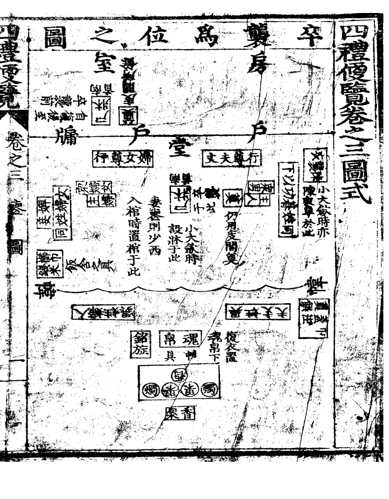

<!-- p.126 | 卷三 圖式 1a | 시안 -->

### 卒襲爲位之圖

방위: 위가 北, 오른쪽이 東. 표 안은 북쪽에서 남쪽으로, 같은 줄에서는 동쪽에서 서쪽으로 적었다.

표시: `「 」` 네모 테두리, `〔 〕` 둥근 테두리, `／` 지면에서 줄이 바뀌는 곳.

#### 室·房 (벽 북쪽)

| 자리 | 도식의 글자 | 곁의 글 |
|---|---|---|
| 동북 | 房 | |
| 벽, 房 앞 | 戶 | |
| 서북 | 室 | |
| 室 안, 동 | 「奠」 | 度[?]閣所餘 |
| 室 안, 가운데 | 「尸牀」 | 南首 |
| 室 안, 서 | | 自復後至／卒襲前 |
| 벽, 室 앞 | 戶 | |
| 벽, 서 | 牖 | |

#### 堂 (휘장 안)

| 자리 | 도식의 글자 | 곁의 글 |
|---|---|---|
| 북 가운데 | 堂 | |
| 동 끝 | 「陳襲衣」 | 小大斂時亦／陳衣卓於此 |
| 동 | 「同姓期功以下」 | |
| 동, 북쪽 줄 | 「丈夫尊行」 | |
| 尸牀 동쪽 | 「衆男」「主人」 | 主人이 한 칸 아래, 尸牀에 가깝다 |
| 尸牀 바로 동쪽 | 「奠」 | 仍用度[?]閣奠 |
| 가운데 | 「尸牀」 | 南首　卒襲／于此　小大斂時／設牀于此 |
| 尸牀 서쪽 | | 妻喪則少西　入棺時置棺于此 |
| 서, 북쪽 줄 | 「婦女尊行」 | |
| 서 | 「主婦」「衆婦女」 | 主婦가 한 칸 아래, 尸牀에 가깝다 |
| 서 | 「同姓婦女」 | |
| 서 끝 | 「妾婢」 | |
| 서남 | 「櫛巾／錢米」 | 飯含之具 |
| 남쪽 경계, 동서 양 끝 | 幃 | 두 글자 사이를 물결 선(휘장)이 잇는다 |

#### 휘장 남쪽

| 자리 | 도식의 글자 | 곁의 글 |
|---|---|---|
| 동 끝 | 「奠饌／盞注／巾」 | |
| 동 | 「異姓丈夫」 | |
| 서 | 「異姓婦人」 | |
| 魂帛 동쪽 | | 復衣置／魂帛下 |
| 가운데 | 「魂帛」 | 帕具 |
| 魂帛 서쪽 | 「銘旌」 | |
| 魂帛 남쪽의 상 | 「〔酒〕／〔燭〕〔果〕〔果〕〔燭〕」 | 〔酒〕가 북쪽 줄, 나머지가 남쪽 줄 |
| 남 끝 | 「香案」 | |

<!-- 확인: 度閣 — 지면 자형은 度에 가깝다. 선반을 뜻하는 庋閣으로 보이나 지면대로 적음 -->
